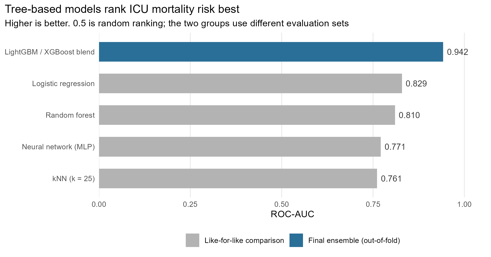

::: {.project-summary}
- **Problem:** Rank ICU patients by their risk of dying in hospital, using what is known when they arrive, so attention goes to the highest-risk patients first.
- **Approach:** Five model families compared under one fixed preprocessing recipe, then a LightGBM and XGBoost blend tuned with repeated cross-validation.
- **Result:** Out-of-fold ROC-AUC of 0.942; the top grade band started at 0.94. Logistic regression beat the neural network.
- **Skills:** R, tidymodels, LightGBM, XGBoost, feature engineering, cross-validation.
:::

## The question

Given only what is known about a patient at the moment they arrive in intensive
care, how well can we predict whether they will die before discharge? The purpose
is triage rather than explanation - ranking patients so that limited clinical
attention flows toward the people most likely to need it.

The work was a Kaggle competition for a machine learning unit, graded on ROC-AUC
on a hidden test set in bands topping out at 0.94. Submissions had to be
probabilities, so nothing could be tuned to a threshold, and the leaderboard only
showed the score on half the test set - the mark came from the other half.

## Data and cleaning

A preprocessed extract of MIMIC-III, one row per ICU stay: first-day vital signs
summarised as min, max and mean, demographics and admission details, plus a
separate table of ICD-9 diagnosis codes. The outcome, `HOSPITAL_EXPIRE_FLAG`, is
positive for roughly 11.2% of stays.

Three parts needed care:

**Age had to be reconstructed.** MIMIC shifts the date of birth of any patient over
89 roughly 300 years into the past as a de-identification measure, so a naive
`ADMITTIME - DOB` returns ages in the hundreds. Ages were capped at 90, with an
indicator kept, because being old enough to be date-shifted is itself a signal.

**The diagnosis columns were unusable raw.** Free-text `DIAGNOSIS` held about 5,000
unique values and behaved as an ID column, so it was dropped. The 555 ICD-9 codes
were rolled into the ~17 standard chapters, and for the boosting pass also
multi-hot encoded over the 300 most common codes.

**Derived features carried more signal than raw levels:** per-vital ranges, shock
index and pulse pressure. A heart rate of 110 means something different at a
systolic pressure of 140 than at 80.

```{r}
#| label: feature-engineering
fe_basic <- function(df) {
  df |>
    mutate(
      age_days    = as.numeric(difftime(ADMITTIME, DOB, units = "days")),
      AGE         = pmin(pmax(age_days / 365.25, 0), 90),
      AGE_OVER_89 = as.integer(age_days / 365.25 > 89),

      HeartRate_Range = HeartRate_Max - HeartRate_Min,
      SysBP_Range     = SysBP_Max     - SysBP_Min,

      ShockIndex    = HeartRate_Mean / na_if(SysBP_Mean, 0),
      PulsePressure = SysBP_Mean - DiasBP_Mean
    ) |>
    select(-DOB, -ADMITTIME, -Diff, -DIAGNOSIS, -age_days)
}
```

Encoding is the step most likely to fail silently. Levels are fitted on train and
applied to test, so an unseen test level becomes `NA` instead of quietly shifting
every column to its right:

```{r}
#| label: categorical-encoding
for (c in cat_cols) {
  lev <- unique(train_fe[[c]])
  # -1L because factor() codes from 1, while LightGBM wants categoricals from 0
  train_fe[[c]] <- as.integer(factor(train_fe[[c]], levels = lev)) - 1L
  test_fe[[c]]  <- as.integer(factor(test_fe[[c]],  levels = lev)) - 1L
}
```

[View the code on GitHub](https://github.com/tlabagala/your-repo)

## Method, and why this one

The project ran in two passes. The first held preprocessing fixed - rare-level
consolidation, one-hot encoding, then standardisation - and swapped only the model,
so any difference in score came from the model family rather than the features.
Five families were compared: logistic regression, kNN at k = 25, a random forest, a
16-unit single-layer MLP, and XGBoost.

The second pass took the winning family and pushed it: richer diagnosis features,
stratified cross-validation repeated over 3 seeds x 5 folds with early stopping,
and a 70/30 blend of LightGBM and XGBoost. Repeating the folds matters at an 11%
positive rate, where a single 5-fold split carries enough noise to move the
estimated AUC on its own:

```{r}
#| label: lightgbm-cv
for (seed in c(42L, 123L, 2024L)) {
  fold_idx <- make_folds(y, N_SPLITS, seed)   # stratified on the outcome
  seed_oof <- rep(0, length(y))

  for (k in seq_along(fold_idx)) {
    va <- fold_idx[[k]]
    tr <- setdiff(seq_along(y), va)

    dtr <- lgb.Dataset(X[tr, ], label = y[tr], categorical_feature = cat_cols)
    dva <- lgb.Dataset(X[va, ], label = y[va], categorical_feature = cat_cols,
                       reference = dtr)

    m <- lgb.train(c(lgb_params, list(seed = seed)), dtr, nrounds = 4000L,
                   valids = list(val = dva), early_stopping_rounds = 100L)

    seed_oof[va] <- predict(m, X[va, ])       # each row scored by a model
    test_lgb     <- test_lgb + predict(m, X_test)   # that never saw it
  }
  oof_lgb <- oof_lgb + seed_oof
}
```

The blend weight came from the centre of the flat region of the weight sweep
rather than its peak, since picking the exact top of a noisy curve is a quiet form
of overfitting the validation set.

Boosting rather than a linear model because clinical risk is threshold-like - an
SpO2 below 88 is categorically bad - which trees represent natively. Two boosting
libraries rather than one because LightGBM grows trees leaf-wise and XGBoost
level-wise, so their errors are partly decorrelated and the average beats either
alone.

> Logistic regression beat the neural network. On tabular data of this size, model
> capacity is not free - the extra flexibility has to be paid for in data, and here
> it could not be afforded.

## Findings

::: {.column-page}
{.figure-wide}
:::

Within the controlled comparison the ordering was kNN 0.761, MLP 0.771, random
forest ~0.81, logistic regression 0.829. Logistic regression finishing ahead of the
neural network suggests mortality risk is broadly additive in these inputs, which
is exactly the structure a linear model captures most efficiently. The kNN result
is structural rather than a tuning failure: after one-hot encoding, distances
concentrate, and a 25-patient neighbourhood contains under three deaths on average.

The final blend reached 0.942 out-of-fold. That number is not comparable to the
four above it - it comes from a different evaluation scheme on a feature set
several hundred columns wider, so much of the gap is features rather than
algorithm.

## What this means in practice

A model like this would support clinical judgement, not replace it: a hospital
could use it to order a review list so the highest-risk new admissions are seen
first. Two things would have to change before that. The diagnosis codes would need
replacing with information available at admission (see below), and the
probabilities would need calibrating, because a ward planning staffing needs to
know whether a score of 0.3 really means a 30% risk. The cost of errors is also
lopsided - missing a patient who deteriorates is far worse than reviewing one who
did not - so the alert threshold should be set on that trade-off, not on AUC.

## Assumptions and limitations

**Folds were stratified on the outcome, not grouped by patient.** Splitting happened
at ICU-stay level. If a patient contributes more than one stay, their rows can land
in different folds and the model can effectively memorise them, inflating the
out-of-fold estimate. Patient-level splitting via `group_vfold_cv()` is the fix. I
have not quantified how much repeat admission exists in this extract, so I do not
know the size of the effect.

**Diagnosis codes are not available at hour zero.** ICD-9 codes are assigned over
the stay and finalised at discharge, so using them to predict that stay's outcome
is defensible as a retrospective benchmark but would not transfer to real-time use.

**Logistic regression assumes independent observations and linearity in the
log-odds.** The first is questionable for the same repeat-admission reason; the
second was not formally checked.

**The probabilities are ranked, not calibrated.** Rebalancing the positive class
distorts the output scale and averaging fifteen models compresses it toward the
middle. PR-AUC was computed alongside ROC-AUC, which is the right instinct at an
11% base rate, but no calibration plot was produced.

None of this licenses a claim that any feature causes mortality, or that acting on
the model would change an outcome. It supports one claim only: the ranking is
informative.
