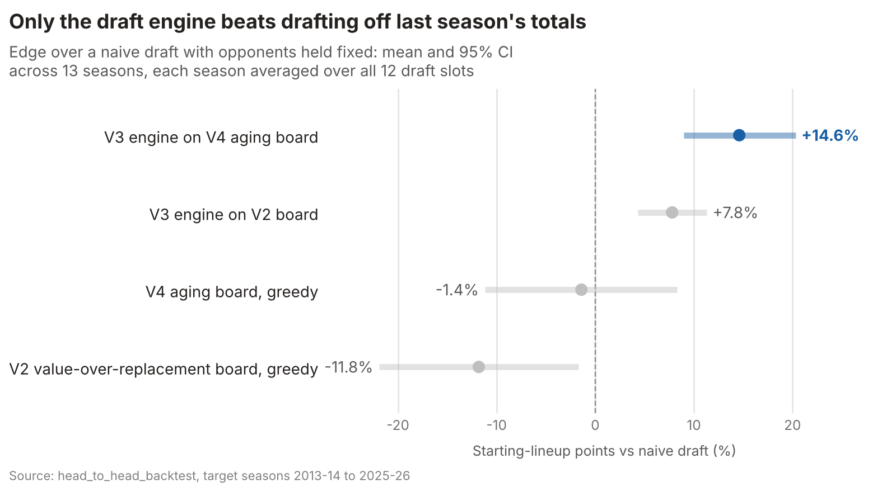
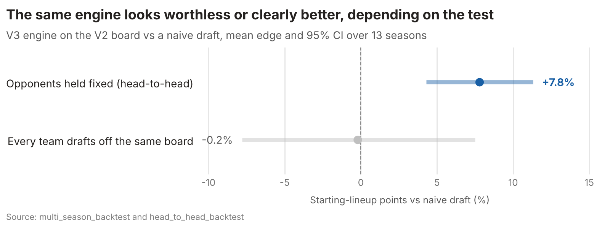

::: {.project-summary}
- **Problem:** Draft a stronger fantasy basketball roster than the usual "last season's totals" cheat sheet, using only information available before the season.
- **Approach:** Player projections with an aging curve, a draft engine that maximises the starting lineup, and a leakage-free backtest over 13 seasons.
- **Result:** +14.6% starting-lineup points over the naive draft, winning all 13 held-out seasons.
- **Skills:** Python, pandas, nba_api, pytest, Streamlit, simulation, backtesting.
:::

## The question

In a fantasy basketball snake draft, twelve managers take turns picking real NBA
players, and each week a team scores points from its starters' box scores. Most
managers draft from a cheat sheet ranked by last season's totals. I wanted to know
whether a model could do measurably better, using only information available
before the season - and how to prove it without fooling myself.

## Data and cleaning

Sixteen seasons of per-game player logs (2010-11 to 2025-26, about 26,000 rows a
season) from the NBA.com stats API via `nba_api`, plus team rosters for positions
and player bios for age, cached to Parquet.

**Absence is data, but only after a player arrives.** A season a player missed
entirely is a durability signal - without it, an early version drafted retired
players. So missed seasons count as zero games, but only from each player's first
appearance, or sophomores are penalised for seasons before they joined the league.

**Missing positions are counted, never dropped.** 208 board players had no
position in the roster data. They are scored against an overall baseline and the
count is reported each run.

**The schema is verified, not assumed.** Column names come from a real pull and are
checked on every load, so a silent API change fails loudly.

[View the code on GitHub](https://github.com/tlabagala/NBA-Fantasy-Draft)

## Method, and why this one

The project was built in versions, each kept only if it beat the one below it:

- **Projection.** Last season's total, then a per-game rate times projected games
  played, an aging curve, and shrinkage toward a positional mean.
- **Board.** Value over replacement, so a scarce centre outranks an equally good
  guard.
- **Draft engine.** Only starters score, so a roster is worth its best legal
  starting lineup, not the sum of all 13 players. The engine picks whoever adds
  most to *my* lineup, plus a penalty for positions about to run dry before my next
  turn. A greedy draft wastes picks on depth it can never start.

The baseline is the naive "last season's totals" draft, not a random one - beating
random by 153% only shows the code is wired up. Every projection for season N uses
only seasons before N, enforced by an assertion and a test that forces it to fail.

> The first backtest gave every team the same board, so upgrading the board
> upgraded the whole league and my edge cancelled out. Holding the other eleven
> teams fixed is what made the effect measurable.

## Findings

With the other eleven teams drafting naively and only my strategy changing,
averaged over all twelve draft positions, the engine on the aging-curve board beat
the naive draft by **14.6%** in starting-lineup points. It won all 13 held-out
seasons (2013-14 to 2025-26) and 85% of the 156 slot-seasons.

::: {.column-page}
{.figure-wide}
:::

Drafting straight down the value-over-replacement board was **11.8% worse** than
naive: it inflated centres, so in 2023-24 it took Embiid and Vucevic while Doncic
sat on the board. The better projection was worth nothing as a ranking on its own
(-1.4%) but compounded through the engine.

Getting a number I trust took more work on the *test* than on the model:

::: {.column-page}
{.figure-wide}
:::

Last season's total proved a hard projection to beat. Only the aging curve
improved it (mean absolute error 501.8 vs 508.9 points) and it cut the systematic
over-prediction from +34.9 to +9.1 points per player. Shrinkage made every metric
worse and was switched off.

## What this means in practice

A better forecast was worth little until a decision rule used it properly. The same
is true of ranking customers by predicted value: deciding who to target with a
fixed budget has constraints, like the roster slots here, that a ranking ignores.
The evaluation lesson transfers too - a comparison where the control group also
changes, like every team drafting off the same board, can hide a real effect
entirely.

## Assumptions and limitations

- **Opponents are simple bots.** The other eleven teams draft greedily and never
  react to my picks, so +14.6% is an upper bound, not a forecast.
- **The league settings are placeholders.** Scoring and roster slots are a
  standard Yahoo-style setup until the Yahoo API connection is authorised.
- **Lineups are scored with hindsight by default.** Re-scoring with lineups chosen
  from the projection instead gives +15.0%, so the conclusion does not depend on it.
- **Thirteen seasons is a small sample.** After averaging the 12 draft slots, each
  season is one result, treated as independent. That separates +14.6% from zero
  (95% CI 9.0% to 20.3%) but does not pin down its size, and two COVID-shortened
  seasons add noise.
- **The aging curve has survivorship bias.** It only sees players who lasted
  another season, so late-career decline is understated.
- **No rookies, no bench value.** Players with no NBA history are absent, and
  in-season moves like streaming and trades are not modelled.

None of this licenses a claim that the tool wins leagues - the draft is only a
modest lever. It shows a decision rule that reliably beats the cheat sheet most
managers use.

## Reproducing this

Python with `pandas`, `nba_api`, `plotnine` and `pytest`, plus a Streamlit app for
draft day. The 72 tests run offline in seconds; a full backtest needs about 10
minutes of one-off API pulls. The
[code repo](https://github.com/tlabagala/NBA-Fantasy-Draft) README lists every
result table.
