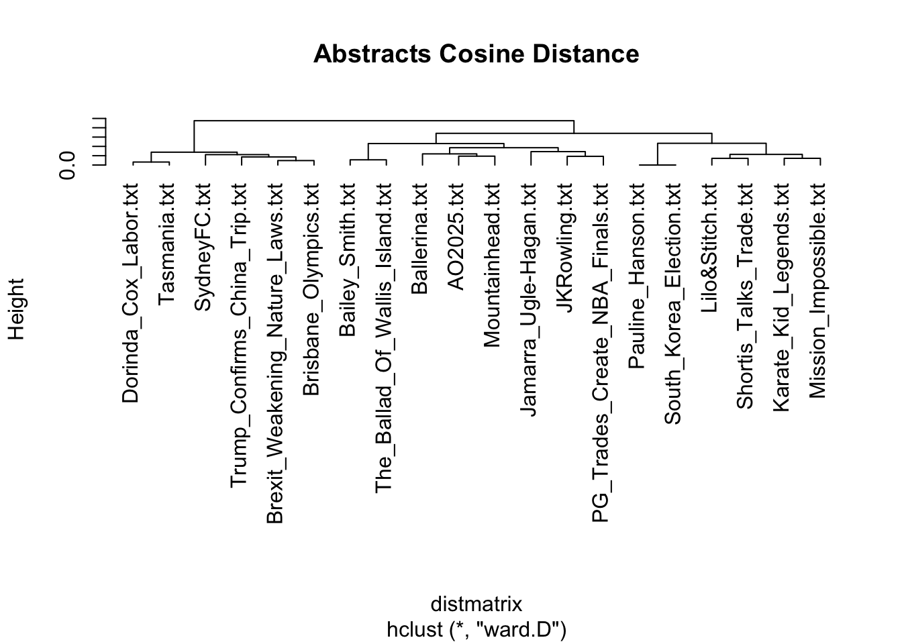
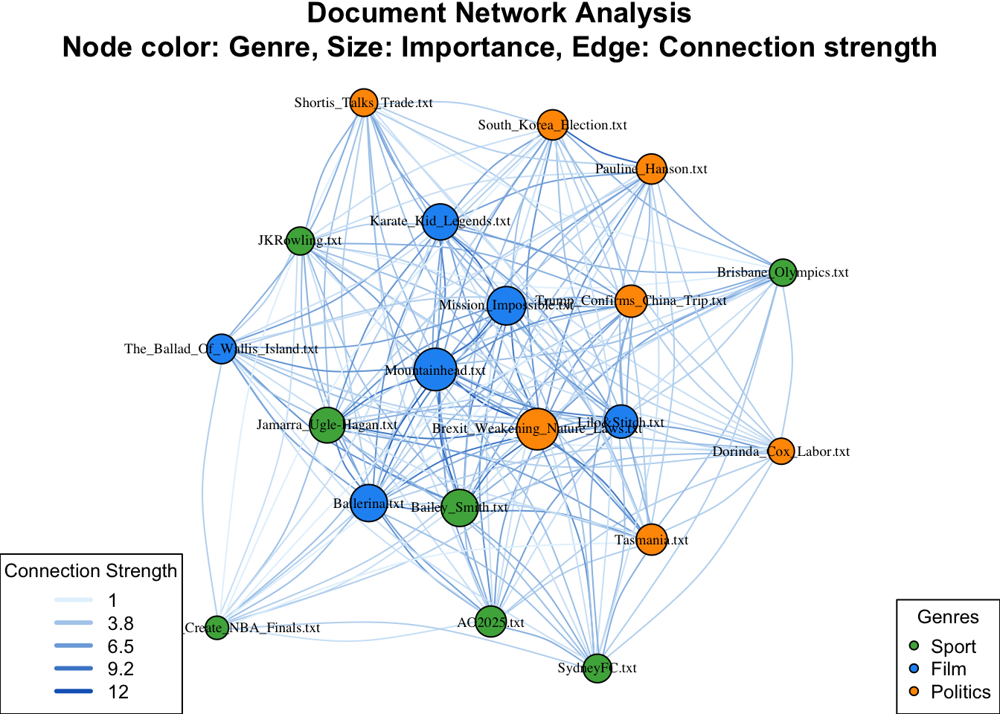
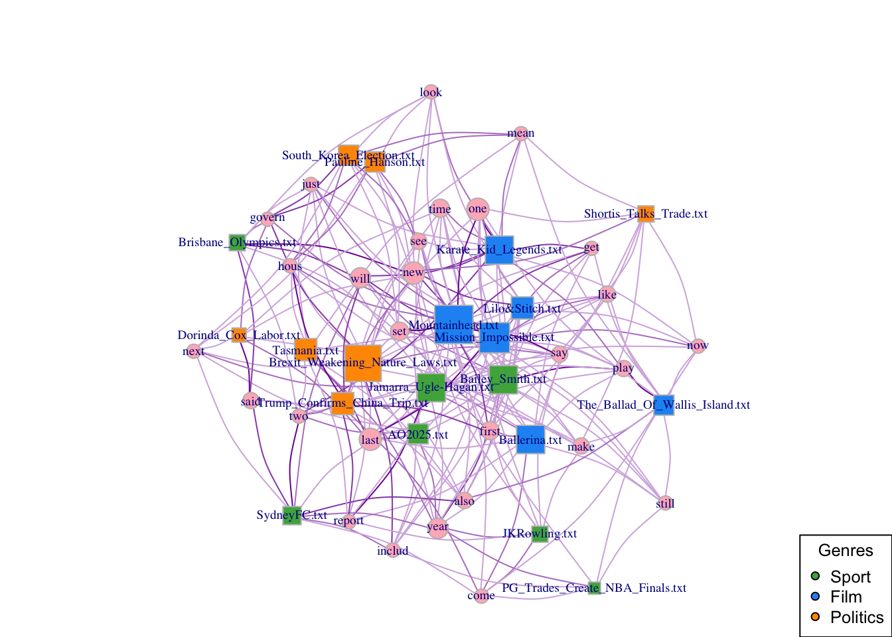
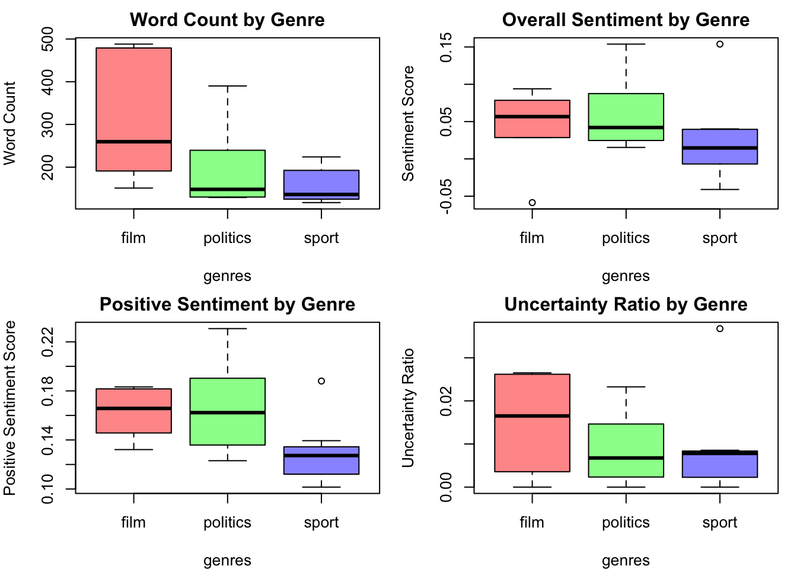

## The question

Given only the words a news article uses - no author, no section, no tags - can
you work out what kind of article it is? I built a corpus of 20 articles across
three genres (sport, film, politics) and tested whether unsupervised methods
could recover those genre labels from term frequencies alone. The labels were
held back and used only to score the result.

## Data and cleaning

The corpus is 20 news articles published between November 2024 and June 2025,
drawn from the BBC, the Guardian, ABC News, news.com.au, ESPN, Variety, Time Out
and The Conversation. Each was saved as a plain text file named for its subject,
giving a roughly even split: 7 sport, 6 film, 7 politics.

Preprocessing followed the standard `tm` pipeline - strip numbers and
punctuation, lowercase, drop English stopwords, collapse whitespace, then stem
with Snowball. Three tokens survived and had to be removed by hand: the en dash,
the opening curly quote, and the possessive `'s`. All three are non-ASCII, so
`removePunctuation` never touched them - a reminder that a textbook pipeline will
not match real scraped text without inspection.

The document term matrix was then trimmed with `removeSparseTerms(sparse = 0.7)`,
leaving 20 documents by 28 terms. That threshold is aggressive: it keeps only
terms appearing in at least 30% of documents, which makes the matrix small enough
to visualise but also, as it turns out, strips most of the genre-specific
vocabulary.

[View the code on GitHub](https://github.com/tlabagala/news-genre-text-mining)

## Method, and why this one

Hierarchical clustering on cosine distance, with Ward linkage. Cosine rather
than Euclidean because these documents differ substantially in length - the film
reviews run to nearly 500 words while several sport pieces are under 150. On raw
counts, Euclidean distance would read that length gap as topical difference and
cluster long documents with long documents. Cosine normalises it away by
comparing direction rather than magnitude.

I then cut the tree at k=3 to match the three known genres, and separately built
two co-occurrence networks from the binary document-term matrix: one linking
documents that share terms, one linking terms that share documents. Eigenvector
centrality on each identified the structurally important nodes.

> Clustering gave a single hard label per document. The network showed that
> several documents genuinely sit between genres - which is the more honest
> description of what modern journalism looks like.

## Findings

Clustering recovered the genre labels for 12 of 20 documents, or 60% accuracy
against a 33% baseline. Better than chance, but a long way from reliable.

::: {.column-page}
{.figure-wide}
:::

The errors are informative rather than random. The Brisbane Olympics article is
labelled sport but landed in politics - it is largely about Queensland government
funding. The Sydney FC piece is a sports story about a chairman appointment, and
shares governance vocabulary with political reporting. Three political articles
landed in the film cluster, all beside action films whose reviews borrow the
language of conflict.

The document network makes the overlap visible in a way the dendrogram cannot.

::: {.column-page}
{.figure-wide}
:::

Five of the six film articles rank among the most central documents - an artefact
worth naming, since film reviews are the longest documents here and so carry more
of the surviving high-frequency terms. Centrality is partly measuring length.

The token network explains the 60% ceiling directly. After sparse-term removal the
most central terms are `last`, `one`, `will`, `new` and `time` - generic
journalistic filler that appears everywhere and discriminates nothing. Only the
bipartite document-term view shows genre structure cleanly, with `govern` linking
strongly to most political articles.

::: {.column-page}
{.figure-wide}
:::

Sentiment analysis was a secondary check. Across nine one-sided t-tests, only two
reached significance: politics and film both score higher on positive sentiment
than sport. Overall sentiment and uncertainty showed no significant differences
between any pair of genres.

## Assumptions and limitations

The honest summary is that this shows the method working, not a result worth
trusting.

- **n = 20 is far too small.** With 6 to 7 documents per genre the t-tests have
  almost no power. I did not correct for multiple comparisons across the nine
  tests, and under a Bonferroni adjustment neither significant result survives.
- **The corpus is not a random sample.** I chose the articles myself, so my own
  sense of a typical sport or film piece is baked into both sample and labels.
- **Genre labels are my own judgement.** Misclassifications concentrate in
  documents that genuinely span topics, so part of the 40% error is disagreement
  about the label rather than failure of the clustering.
- **k=3 was imposed, not discovered.** I cut the tree at the number of genres I
  already knew, and did not check whether the dendrogram supports three clusters.
- **Centrality is confounded with document length,** which I did not normalise
  for. That film articles are central is partly a finding that they are long.
- **`sparse = 0.7` was tuned for legible networks, not for accuracy.** It removed
  the genre-specific vocabulary the task needed, and is the most likely cause of
  the 60% ceiling. I did not test other thresholds.
- **Stemming is lossy and was not validated.** Snowball produces `hous`,
  `includ`, `govern`; I did not check what it merged.

What this does not license: any claim about news genres in general, or that 60%
is the achievable accuracy here. A larger corpus with a tuned sparsity threshold
would almost certainly do better.

## Reproducing this

Written in R with `tm`, `SnowballC`, `SentimentAnalysis`, `proxy` and `igraph`,
as four sequential scripts in the
[code repo](https://github.com/tlabagala/news-genre-text-mining).

The corpus is 20 copyrighted news articles and is not redistributed, but the
derived document-term matrix is - so the clustering and all three network
figures reproduce from the repo alone, with no corpus needed. `SOURCES.md` lists
every article URL if you want to rebuild it and re-run the sentiment step. The
layout seed is fixed, so the network figures come out identical.
