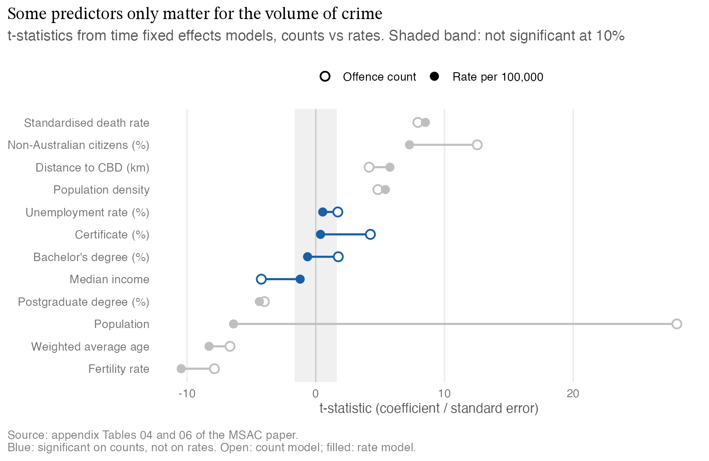

::: {.project-summary}
- **Problem:** Find which demographic and economic factors explain differences in crime rates across Victoria's 78 LGAs.
- **Approach:** A 2011-2024 panel of 1,092 LGA-years, modelled with pooled OLS, fixed effects, factor analysis, LASSO and elastic net.
- **Result:** Fertility and education go with lower crime, and unemployment and density with higher; elastic net predicted best (test R² 0.777).
- **Skills:** R, panel econometrics, fixed effects, regularisation, choropleth mapping, data integration.
:::

## The question

Which demographic and economic factors explain the differences in crime rates
across Victoria's 78 local government areas (LGAs) between 2011 and 2024? This
was a student research project for the Monash Statistical Analytics Club
(MSAC), written with Sanjana Bhavin Lakhpatwala and Sayali Choudhary.

## Data and cleaning

The panel covers 78 LGAs over 14 years (1,092 LGA-years). It joins Crime
Statistics Agency Victoria offence data to ABS census data and other public
indicators. Census variables only exist for 2011, 2016 and 2021, so each value
was carried forward to the following years. A census-years-only regression gave
the same signs and significance, which supports the fill. Unemployment is
published by region, so each LGA was given its region's rate.

## Method, and why this one

The models build on each other: pooled OLS as a baseline, then LGA, time and
combined fixed effects, then factor analysis, LASSO and elastic net to deal with
strongly correlated predictors. The time fixed effects model removes shocks
that hit every LGA in the same year. The combined model also removes anything
constant about each LGA, so what remains is change within an LGA over time.

> A variable can point one way when you compare LGAs with each other and the
> opposite way when you follow one LGA over time.

## Findings

Fertility rate and education go with lower crime, and unemployment and
population density with higher crime. Citizenship mix is significant across
models, likely reflecting wider demographic and urban patterns rather than a
direct effect.

Bachelor's degree share shows why fixed effects matter. It is positive in the
time fixed effects model, since inner Melbourne is both highly educated and
high crime, but strongly negative within LGAs in the combined model (-245.5,
p < 0.001).

Elastic net gave the best out-of-sample accuracy and was selected for
prediction. The fixed effects models remain the better tool for explaining
change within an LGA.

## What this means in practice

The paper's conclusion points policy toward education, employment and
community stability as levers for reducing crime locally. The wider lesson carries over to any
regional data: a pattern across areas, like educated councils having more
crime, can reverse within each area over time. Before acting on a cross-area
comparison, check whether the effect holds once each area is compared with
itself.

## The full paper

<iframe src="../assets/papers/victorian-lga-crime-msac-2026.pdf" width="100%" height="800" style="border: 1px solid #ddd;" title="Exploring predictors of crime rates across Victorian LGAs from 2011-2024"></iframe>

[Download the paper (PDF)](../assets/papers/victorian-lga-crime-msac-2026.pdf)

## Assumptions and limitations

As set out in the paper:

- Education and citizenship are census-only and were carried forward, which
  assumes they change gradually.
- Unemployment is assigned at regional rather than LGA level, which may add
  measurement error.
- Models use different outcomes (crime rate vs offence count) and
  transformations, so RMSE and MAE are not directly comparable and model
  selection leans on MAPE.
- Fixed effects cannot account for time-varying omitted variables such as
  policing intensity, policy changes or social programs.
- LASSO and elastic net coefficients are biased by shrinkage and should be
  read as predictive, not causal.
- Results are area-level associations, so applying them to individuals risks
  the ecological fallacy.
