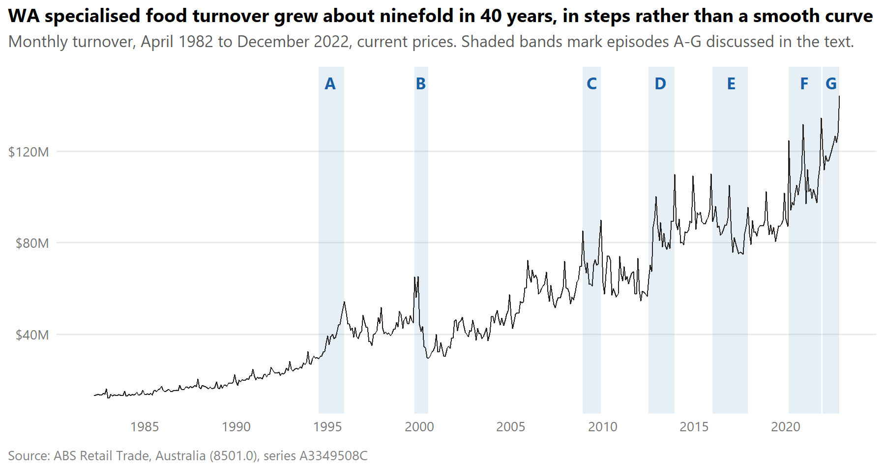
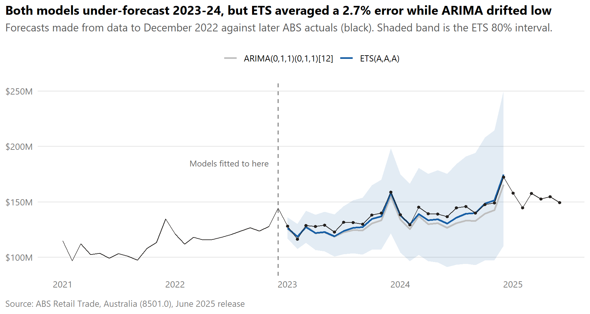

::: {.project-summary}
- **Problem:** Forecast two years of monthly turnover for Western Australia's specialised food retailers (butchers, bakeries, fruit and vegetable shops).
- **Approach:** A log transform and STL decomposition, then shortlists of ARIMA and ETS models compared on a 24-month holdout and checked against ABS data released later.
- **Result:** On 2023-24, ETS(A,A,A) had a 2.7% average error (MAPE), against 4.7% for ARIMA, which fell below the actual value in 23 of 24 months.
- **Skills:** R, fpp3 (fable, feasts, tsibble), Box-Cox transforms, STL, ARIMA, ETS, unit-root tests, residual diagnostics.
:::

## The question

How accurately can you forecast a retail sector's monthly turnover two years
ahead, using nothing but its own history? And when two reasonable models
disagree, which one should you trust? This was the main project for Monash's
ETC3550 Applied forecasting unit. It is judged here against data that was
released after the forecasts were made.

## Data and cleaning

The series is ABS *Retail Trade, Australia* (8501.0), series A3349508C: monthly
turnover for WA's "other specialised food retailing" subgroup. That covers food
retailers other than supermarkets and liquor stores. It runs from April 1982 to
December 2022 (489 months), in current dollars and not seasonally adjusted.

The series is not a smooth curve. Average monthly turnover rose about ninefold,
from \$13M in 1983 to \$122M in 2022. Most of that rise came in steps that line
up with WA events, such as the 2012-13 peak of the mining boom and its 2016-17
slump. A robust STL decomposition flagged 11 unusual months, and I matched each
one to a likely cause before modelling. Examples are Y2K stockpiling, the first
month of the GST, an April-June 2010 jump that looks like an ABS sample change,
and March 2020 panic buying.

## Method, and why this one

**Transformation.** The seasonal swings grow with the level, so I took a log.
Guerrero's method suggested $\lambda = -0.29$. That estimate was pulled around by
the level shifts, while the log evened out the variance just as well and lets
results be read as percentages.

**Differencing.** KPSS supported a seasonal difference alone. But annual growth
drifted away from its average for years at a time, so I also took a first
difference and kept a $d = 0$ model as a check. That model did worse on the test
set (6.3% against 5.0% MAPE).

**Model choice.** I picked ARIMA orders by hand from the ACF and PACF and used the
automatic search only as a check. The hand-picked "airline" model,
ARIMA(0,1,1)(0,1,1)~12~, beat the automatic choice by about 89 AICc points. The
search missed it because `fable` rules out a seasonal MA coefficient this close
to -1. AICc can't compare an ARIMA model with an ETS model, because they compute
likelihoods differently, so the final choice between them was made on the
holdout.

> The refitted ETS model won because it learned faster growth from the last two
> years of data. That sensitivity is also its main risk.

## Findings

On the 2021-22 holdout, ETS(A,A,A) beat the ARIMA model on every accuracy measure
(RMSE \$5.9M against \$6.5M, MAPE 4.5% against 5.0%). Both over-forecast 2021,
because training ended just after the COVID-19 jump, when 2020 turnover averaged
19% above 2019.

I then refitted both models on all the data to December 2022. The ARIMA estimates
barely moved. The ETS growth parameter rose from almost zero to 0.028, which lifted
its forecast growth from about 5% to 7% a year. The ABS released 2023-24 data
afterwards, so I could check both forecasts:

Actual turnover averaged \$132M a month in 2023 and \$144M in 2024. ETS forecast
\$129M and \$141M, a MAPE of 2.7% and a MASE of 0.60, so its errors were well
below those of a seasonal naive forecast. ARIMA forecast \$127M and \$136M, with a
MAPE of 4.7% and a MASE of 1.09. Its errors were systematic rather than random.
Every actual value from both models fell inside its 80% interval, so the
intervals were wider than they needed to be.

## What this means in practice

A two-year turnover forecast like this would support supplier contracts,
staffing and stock planning for a food retailer or wholesaler. The project
suggests a simple way to use it. Plan around the more adaptive model, but keep
the conservative one as a floor scenario, since the two models only parted ways
once recent growth dominated. Before relying on either, check whether the
drivers of recent growth (population growth and food inflation) are expected to
continue. Neither model can see them.

## Assumptions and limitations

- **Current dollars.** The series isn't adjusted for inflation, so part of the
  "growth" is price change. If inflation shifts, both forecasts go wrong in the
  same direction.
- **Univariate models.** Both use only past turnover. They can't anticipate
  shocks like the GST or COVID-19, or use drivers such as WA population growth.
- **The ETS win is partly luck.** Its advantage came from a parameter that moved
  when two unusual years (post-COVID levels and food inflation) were added. Had
  growth slowed in 2023-24, ARIMA would probably have done better.
- **A short, distorted holdout.** Model selection rested on 24 test months that
  started just after the COVID-19 jump.
- **Prediction intervals.** The residuals have long tails (kurtosis about 9,
  against 3 for a normal distribution). That inflates the estimated variance, so
  the intervals were too wide for ordinary months and say little about rare
  shocks.
- **Residual checks.** The ARIMA residuals pass the Ljung-Box test (p = 0.31).
  The ETS residuals only just pass (p = 0.058) and show some lag-1
  autocorrelation it doesn't model.
- **No more updates.** The ABS stopped this publication after June 2025, so the
  forecasts can't be checked beyond that.

None of this supports claims about *why* turnover grew. The models describe
patterns in the series. They don't explain them.

## The full report

The complete report covers 11 sections: exploration, the transformation and STL
choices, unit-root tests, every candidate model, residual diagnostics, the
forecasts and the ABS check. All the R code is in folded blocks. The data loads
from the public Monash retail dataset and the ABS website, so the report runs
from scratch.

<iframe class="report-embed" src="../assets/reports/wa-retail-forecasting-report.html" loading="lazy" title="Forecasting Western Australian specialised food retailing turnover: full report"></iframe>

[Open the full report in a new tab](../assets/reports/wa-retail-forecasting-report.html){target="_blank"}
